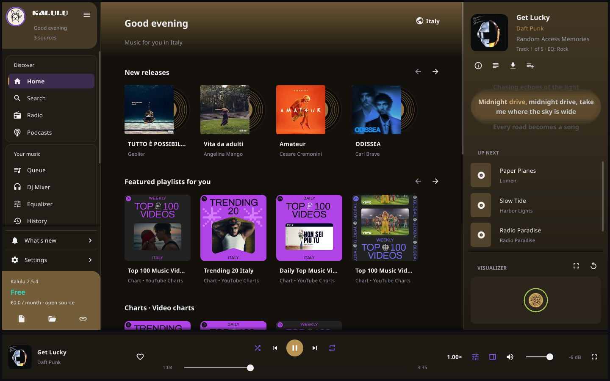
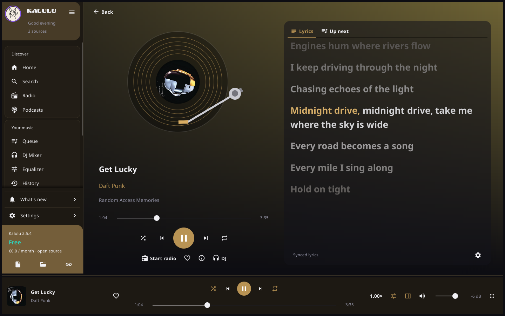
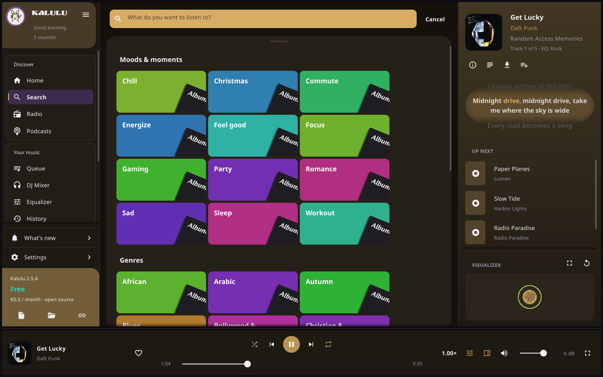
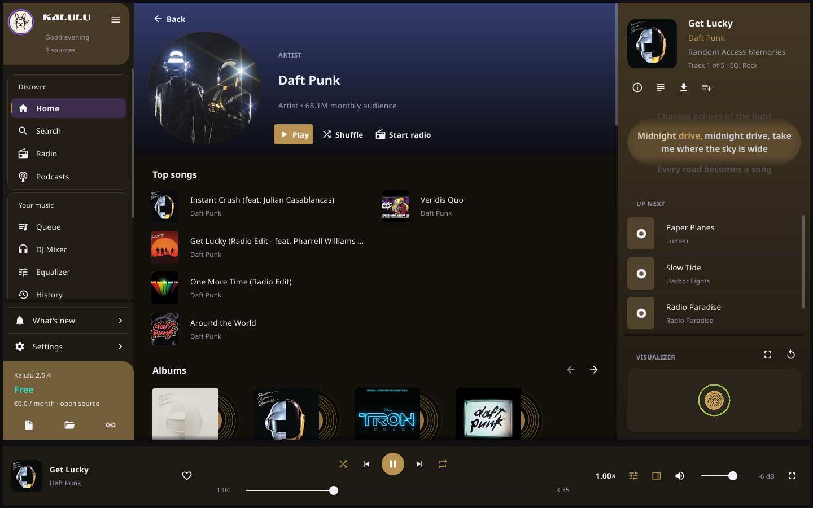
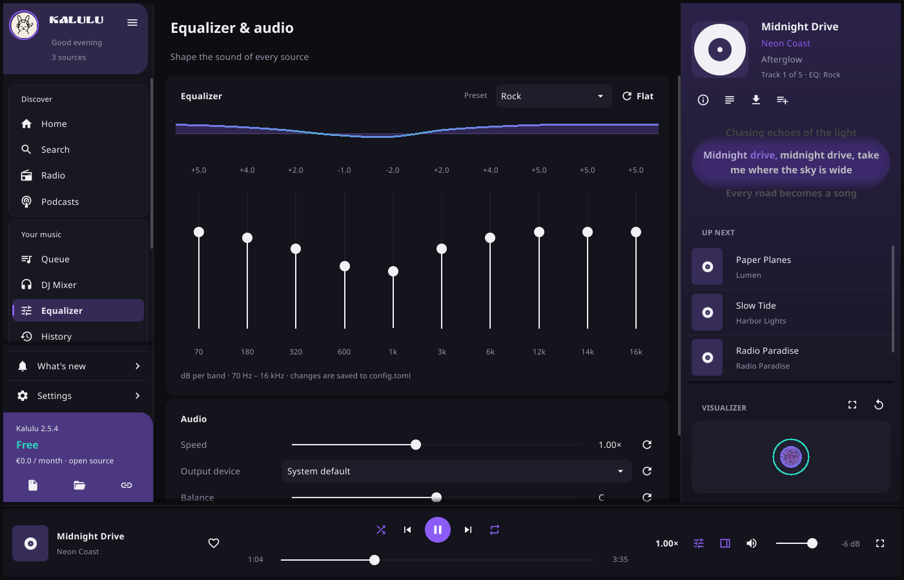

<p align="center">
  
</p>

<h1 align="center">Kalulu</h1>

<p align="center">
  A modern, light and complete music player for Linux and Windows.<br>
  YouTube Music, radio, podcasts, local files and your own services, with a DJ Mixer, word-by-word synced lyrics and listening together on your local network.
</p>

<p align="center">
  <b>Version 2.5.4</b> · formerly GuiAmp · a graphical fork of <a href="https://github.com/bjarneo/cliamp">cliamp</a> · GPL-3.0
</p>



## Why Kalulu

Kalulu puts a modern window on the engine of [cliamp](https://github.com/bjarneo/cliamp), a fast and well-tested terminal player. It needs no account: Home suggests YouTube Music for your country, and every card plays with one click. Services you already use (Navidrome, Jellyfin, Plex, Spotify, Tidal, Qobuz…) show up in the Library.

The whole window takes its colors from the cover of the playing song: the sidebar, the panels, the search bar, the record on the player page and the glow behind the lyrics all change with every track, always with readable text.



## What's new in 2.5.4

A new look, drawn from the Kalulu mobile design and rebuilt for the desktop:

- **Sidebar**: a profile card with the KALULU wordmark in Ruslan Display, the sections in bordered cards, What's new and Settings rows, and a plan card with the quick open buttons.
- **Search**: a search bar in the accent color with Cancel, and the moods and genres on a sheet of colored tiles, each with a tilted album sleeve.
- **Vinyl player**: Settings → Personalization → Player cover shows the cover or a vinyl record with the cover as its label. The record turns while the song plays, and the tonearm lowers on play and lifts on pause.
- **Album cards** show the cover with its record sliding out on the right.
- **Now playing panel**: three lines of synced lyrics with a glow behind the sung one, the whole queue in a scrolling list, and the visualizer fixed at the bottom.
- **Full screen** button at the right end of the player bar; leaving full screen no longer cuts the window edges.
- Smoother lyrics: lines fade gradually with their distance from the sung one.



## Features

**Discover and listen**
- Modular Home: mixes made for you from what you listen to, YouTube Music, charts, moods and genres, and the radio and podcasts of your country. You pick the sections and their order.
- Search with suggestions as you type: songs, artists, albums, videos and playlists. With an empty field, the moods and genres of YouTube Music show as colored tiles.
- Autoplay: when the queue ends, similar songs keep playing.
- Radio from all over the world ([Radio Browser](https://www.radio-browser.info)) and the Apple podcast charts.
- Local files, folders, URLs, M3U and PLS playlists and feeds. Just drop them on the window.

**Audio**
- Fast start: YouTube tracks play from their direct audio URL, and the next tracks of the queue are prepared in advance.
- Opus streaming quality: high, balanced, data saver, or automatic from your connection.
- Gapless preload, skipping of the silence at the start and end of tracks, and recovery from errors.
- 10-band equalizer with presets, loudness normalization, L/R balance, mono and speed.

**DJ Mixer**
- Analyses the tempo, beats, phrases, key and energy of every track.
- Mixes like a DJ: beat alignment, tempo matching, filters, echo and fades.
- Presets Smooth, Beat Match, Long Mix, Quick Mix and Manual, with length, intensity and a preview.

**Lyrics**
- Karaoke-style lyrics synced word by word, with smooth animation and full screen. The lines fade gradually with their distance from the sung one.
- The now playing panel follows the song in three lines: the one before, the sung one with a glow, and the next.
- Nine free sources asked at once, with no account: LyricsPlus, lrc.red and Paxsenix (Apple Music lyrics timed per word), LRCLIB, BetterLyrics Unison, NetEase, QQ Music, Kugou and lyrics.ovh. Kalulu keeps the best answer and caches it.
- The gear under the lyrics looks them up again, picks the source and sets the offset.

**Interface**
- The window colors follow the cover of the playing track, always with readable contrast.
- The player page shows the cover, or a vinyl record with the cover as its label that turns while the track plays.
- Album cards show the cover with its record beside it.
- The now playing panel keeps the details and lyrics at the top and the visualizer at the bottom, with the whole queue scrolling between them.
- Visualizer with the NCS sphere that pulses on the beat, plus bars, mirror, radial and more.
- Density, text size, sidebar and reduced motion are all yours to set.
- Tray icon: closing the window keeps the music playing.
- Reopens the queue and the track where you left them.
- Single instance: a second launch brings the window forward and hands it the files.
- Italian and English interface.

**Listening together**
- Open a room with a code and listen together on your local network, in sync within a tenth of a second.
- Roles: Owner, Editor, On request (suggests tracks for approval) and Listener.
- Never exposed to the Internet: the room answers LAN addresses only.

**Light**
- About 300 MB of RAM while playing, steady after hours of listening.
- Covers are kept at the size they are shown. The visualizer and animations stop when the window is hidden.

**Updates**
- Checks the releases of this repository every time it starts and shows a panel when a new version is out. It downloads the AppImage or the Windows installer and installs it only when it matches its `SHA256SUMS`.





## Install

### Windows

Download `Kalulu-<version>-x64-setup.exe` from the [Releases](https://github.com/HubDevCode/Kalulu/releases) page and run it. It installs Kalulu with everything it needs, including `yt-dlp` and `ffmpeg`, and adds it to the Start menu. It needs Windows 10 or 11, 64-bit, and installs for the current user without administrator rights.

The installer is not signed, so Windows SmartScreen may warn about it: choose **More info → Run anyway**.

### AppImage

Download `Kalulu-<version>-x86_64.AppImage` from the [Releases](https://github.com/HubDevCode/Kalulu/releases) page, make it executable and run it:

```sh
chmod +x Kalulu-*.AppImage
./Kalulu-*.AppImage
```

### Requirements

| What | Why |
| --- | --- |
| `yt-dlp` | YouTube, YouTube Music, SoundCloud, Bandcamp |
| `ffmpeg` | AAC, Opus, ALAC, network streams and the DJ Mixer analysis |
| `pipewire-alsa` or `pulseaudio-alsa` | audio output on PipeWire or PulseAudio |

On Linux the AppImage does not include `yt-dlp` and `ffmpeg` (the Windows installer does). If they are missing, Kalulu shows the command that installs them when it starts.

### Build from source

You need Go (the version in `go.mod`), a C compiler and the development files of ALSA, OpenGL, X11 and Wayland.

```sh
# Arch, Manjaro, EndeavourOS
sudo pacman -S --needed base-devel go alsa-lib libglvnd libxcursor libxrandr libxinerama libxi libxxf86vm libxkbcommon wayland flac libvorbis libogg mpg123 yt-dlp ffmpeg

# Debian, Ubuntu, Mint, Pop!_OS
sudo apt install golang gcc pkg-config libasound2-dev libgl1-mesa-dev xorg-dev libxkbcommon-dev libwayland-dev libflac-dev libvorbis-dev libogg-dev libmpg123-dev yt-dlp ffmpeg

# Fedora
sudo dnf install golang gcc alsa-lib-devel mesa-libGL-devel libXcursor-devel libXrandr-devel libXinerama-devel libXi-devel libXxf86vm-devel libxkbcommon-devel wayland-devel flac-devel libvorbis-devel libogg-devel mpg123-devel yt-dlp ffmpeg
```

Then:

```sh
git clone https://github.com/HubDevCode/Kalulu.git
cd Kalulu
make build      # builds ./kalulu
make install    # into ~/.local/bin, with an application menu entry and icon
```

The packages for openSUSE, Void and Alpine, and the Flatpak manifest, are in [docs/gui.md](docs/gui.md). `make appimage` builds the AppImage and its `SHA256SUMS`.

## Usage

```sh
kalulu                          # open the window
kalulu ~/Music/album            # open the window and play a folder
kalulu https://…                # a URL, a playlist, a feed
kalulu --background             # start in the tray
kalulu --room "Party"           # open a shared listening room
kalulu --join HOST:PORT/CODE    # join a room
kalulu --tui                    # the cliamp terminal interface
kalulu -d                       # headless, controlled through the socket
```

Press `F1` in the window for the keyboard shortcuts. Single-letter shortcuts never fire while you type in a text field.

## Configuration

Kalulu reads the cliamp configuration in `~/.config/cliamp/config.toml`, so an existing cliamp setup works at once. Almost everything is in **Settings**, by category: General, Personalization, Home and services, Notifications, Playback, Transitions, Audio, Lyrics, Visualizer, Network, Downloads, Performance, Plugins, Advanced, Updates.

Settings → Advanced exports and imports your preferences. The services (Navidrome, Jellyfin, Plex, Emby, Spotify, Tidal, Qobuz, SoundCloud, Mixcloud…) are set up in Settings → Home and services, and each one has a guide in [docs](docs).

| Path | What it holds |
| --- | --- |
| `~/.config/cliamp/config.toml` | the engine and service configuration |
| `~/.config/cliamp/kalulu-session.json` | the queue and track of the last session |
| `~/.config/cliamp/kalulu-crash.log` | the report of a crash, if one happens |
| `~/.config/fyne/io.kalulu.Kalulu` | the window preferences |
| `~/.cache/kalulu` | covers, DJ analyses and lyrics |

## Documentation

- [docs/gui.md](docs/gui.md): the window, Discover, the DJ Mixer, lyrics, listening together, memory, install.
- [docs/remote-control.md](docs/remote-control.md): remote control over the socket (V2 API).
- [docs/plugins.md](docs/plugins.md): cliamp Lua plugins, which work in Kalulu too.
- [docs/configuration.md](docs/configuration.md): every key of `config.toml`.

## Development

```sh
make build     # build ./kalulu
make test      # go test ./...
make preview   # render the window offscreen to build/preview/*.png
```

The window lives in the `gui/` package. It talks to the cliamp engine only through the V2 operations, wired in `gui_main.go`. The other Kalulu packages:

| Package | What it does |
| --- | --- |
| `discover/` | YouTube Music without an account, podcasts, radio |
| `djmix/` | track analysis and DJ transition planning |
| `player/` | audio engine: preload, mixing, silence, quality, fast YouTube resolution |
| `lyrics/` | lyrics search over many sources, with a cache |
| `share/` | listening together on the LAN |

Pushing a `v*` tag builds the AppImage and publishes the release.

## Credits

Kalulu is a fork of [cliamp](https://github.com/bjarneo/cliamp) by Bjarne Øverli. The engine, the services and the plugins come from there: thank you! The lyrics come from the free services listed above, and music discovery from YouTube Music, [Radio Browser](https://www.radio-browser.info) and the Apple Podcasts charts.

## License

Kalulu is free software: you can redistribute it and modify it under the terms of the [GNU General Public License](LICENSE), version 3 or, at your option, any later version.

Kalulu contains the code of cliamp, © Bjarne Øverli, released under the MIT license. As that license requires, its original notice is kept in [LICENSES/MIT-cliamp.txt](LICENSES/MIT-cliamp.txt).

The KALULU wordmark uses [Ruslan Display](https://fonts.google.com/specimen/Ruslan+Display), © Oleg Snarsky, Denis Masharov and Vladimir Rabdu, under the SIL Open Font License 1.1, kept in [LICENSES/OFL-RuslanDisplay.txt](LICENSES/OFL-RuslanDisplay.txt).
